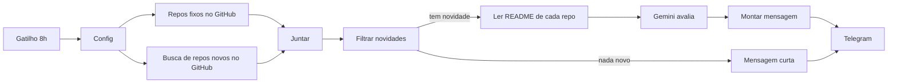

# Radar de skills do Claude Code

[Português](#português) | [English](#english)

## Português

Automação em n8n que me manda, todo dia às 8h, um resumo no Telegram com as skills do Claude Code que vale a pena conhecer. Antes eu descobria skills por acaso, em vídeos no YouTube e no Instagram. Agora recebo só o que é novo, com métricas do GitHub e um veredito de IA: usar, testar ou ignorar.

### Como funciona



1. Fontes. Seis repositórios acompanhados sempre (por exemplo `anthropics/skills` e `mattpocock/skills`) e uma busca na API do GitHub por repositórios com o topic `claude-skills`, pelo menos 10 estrelas e criados nos últimos 7 dias.
2. Filtro. O workflow guarda as estrelas de cada repositório na memória do n8n (static data). Entra no resumo o repositório que nunca apareceu ou que ganhou 500 estrelas ou mais desde a última vez. No máximo 5 por dia; o que sobra fica para os dias seguintes.
3. Análise. O README de cada repositório (até 3000 caracteres) e as métricas vão para o Gemini (`gemini-3.5-flash-lite`) com saída em JSON estruturado: o que é, para quem serve, para que serve, veredito e motivo.
4. Entrega. Uma mensagem no Telegram, ordenada por veredito. Em dia sem novidade, uma linha curta avisando.

### Como rodar

1. Suba o n8n com Docker:
   ```bash
   docker run -d --name n8n -p 5678:5678 -e GENERIC_TIMEZONE=America/Sao_Paulo -e TZ=America/Sao_Paulo -v n8n_data:/home/node/.n8n --restart unless-stopped docker.n8n.io/n8nio/n8n
   ```
2. Crie um bot com o @BotFather no Telegram, mande uma mensagem para ele e pegue o seu chat id em `https://api.telegram.org/bot<TOKEN>/getUpdates`.
3. Crie uma chave da API do Gemini no Google AI Studio.
4. Em http://localhost:5678, importe o `workflow.json`.
5. No nó Gemini avalia, crie uma credencial Header Auth com nome `x-goog-api-key` e a sua chave como valor.
6. No nó Avisar no Telegram, crie a credencial Telegram API com o token do bot.
7. No nó Config, troque `COLE_AQUI_SEU_CHAT_ID` pelo seu chat id.
8. Teste com Execute e depois clique em Publish para rodar todo dia.

Nenhuma chave, token ou chat id fica no `workflow.json`. Tudo isso mora nas credenciais do n8n.

### Limites

- A memória de estrelas só é gravada em execuções do workflow publicado. Em teste manual, todo repositório aparece como novo.
- O n8n roda no meu computador. Se ele estiver desligado às 8h, o resumo do dia não sai.
- Sem token do GitHub, a API permite 60 chamadas por hora. O workflow usa cerca de 12 por execução.
- O veredito é uma opinião do modelo a partir do README e das métricas. Ele não testa a skill.
- Não medi tempo economizado. O ganho é trocar descoberta por acaso por um resumo diário filtrado.

## English

An n8n automation that sends me a daily Telegram digest at 8 am with the Claude Code skills worth knowing about. I used to find skills by chance, in YouTube and Instagram videos. Now I get only what is new, with GitHub metrics and an AI verdict: use, try or ignore.

### How it works

See the diagram above.

1. Sources. Six repositories tracked every day (for example `anthropics/skills` and `mattpocock/skills`) plus a GitHub API search for repositories with the `claude-skills` topic, at least 10 stars, created in the last 7 days.
2. Filter. The workflow stores each repository's star count in n8n memory (static data). A repository makes the digest if it was never seen before or gained 500 or more stars since the last run. At most 5 per day; the rest wait for the following days.
3. Analysis. Each repository's README (up to 3000 characters) and metrics go to Gemini (`gemini-3.5-flash-lite`) with structured JSON output: what it is, who it is for, what it does, verdict and reason.
4. Delivery. One Telegram message, sorted by verdict. On days with nothing new, a short line says so.

### How to run

1. Start n8n with Docker using the command in the Portuguese section.
2. Create a bot with @BotFather on Telegram, send it a message and get your chat id from `https://api.telegram.org/bot<TOKEN>/getUpdates`.
3. Create a Gemini API key in Google AI Studio.
4. Open http://localhost:5678 and import `workflow.json`.
5. In the Gemini avalia node, create a Header Auth credential named `x-goog-api-key` with your key as the value.
6. In the Avisar no Telegram node, create a Telegram API credential with the bot token.
7. In the Config node, replace `COLE_AQUI_SEU_CHAT_ID` with your chat id.
8. Test with Execute, then click Publish to run it daily.

No key, token or chat id is stored in `workflow.json`. They all live in n8n credentials.

### Limits

- Star memory is only saved by runs of the published workflow. In manual tests every repository shows up as new.
- n8n runs on my computer. If it is off at 8 am, that day's digest is not sent.
- Without a GitHub token the API allows 60 calls per hour. The workflow uses about 12 per run.
- The verdict is the model's opinion based on the README and metrics. It does not test the skill.
- I did not measure time saved. The gain is replacing random discovery with a filtered daily digest.
